# O‘qi interfeysi

Darsino Expo ilovasi foydalanuvchi yuborgan `o_qi_interaktiv_mobil_ilova_prototipi.tsx` uslubida qayta ishlangan. Prototipdagi HTML/Tailwind maketi React Native komponentlariga moslashtirildi.

## Ekranlar

| Bosh                          | Qidiruv                            | Radar                           |
| ----------------------------- | ---------------------------------- | ------------------------------- |
| 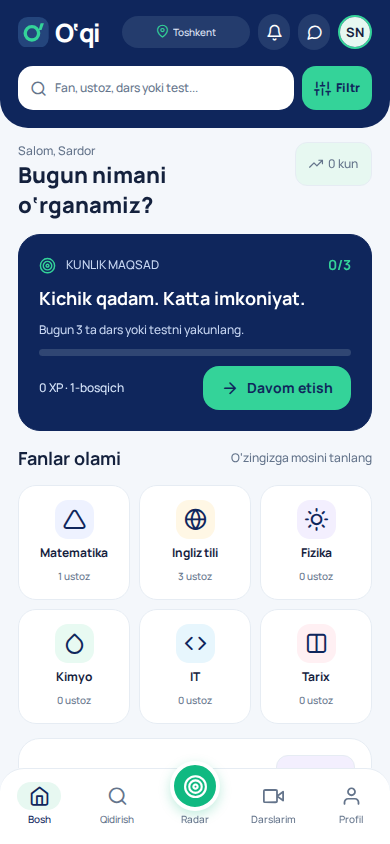 | 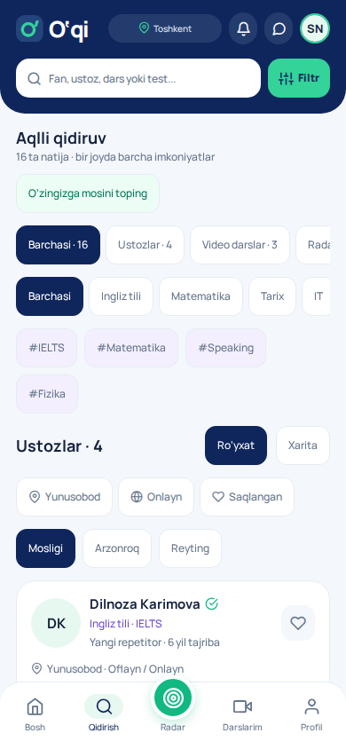 | 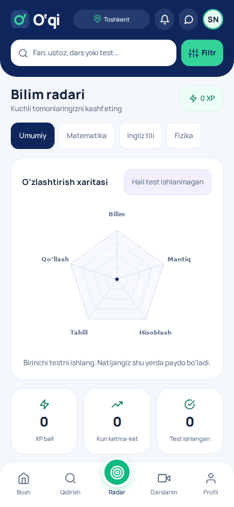 |

| Darslar                             | Klublar                           | Profil                             |
| ----------------------------------- | --------------------------------- | ---------------------------------- |
| 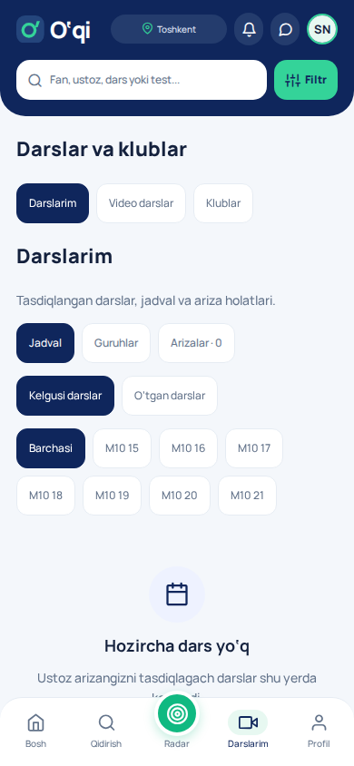 | 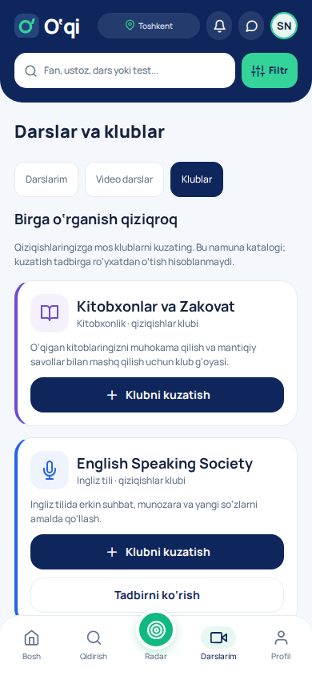 | 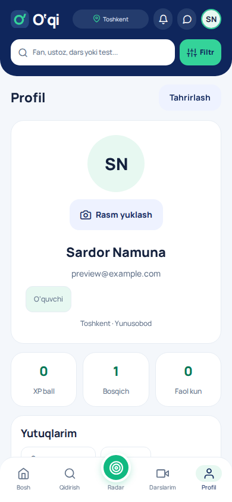 |

Rasmlar 390 × 844 o‘lchamdagi Chromium brauzerida namuna akkaunti bilan olingan. 320 px ekran ham alohida tekshirilgan.

## Mavjud jarayonlarga ulanish

Besh asosiy bo‘lim: **Bosh → Qidirish → Radar → Darslarim → Profil**. Chat yuqoridagi xabar tugmasi va profil orqali ochiladi. Ustoz kabineti ikkinchi `o_qi_ustoz_kabineti_interaktiv_mobil_prototip.tsx` prototipiga moslashtirilgan: **Tahlil → Guruhlar → Xonalar → Klublar → Profil**. Arizalar va chat yuqoridagi belgilar orqali ochiladi. Moderatorning tekshiruv jarayoni saqlangan.

Ustoz kartasi haqiqiy marketplace ma’lumotlarini, narx va sharhlardan hisoblangan reytingni oladi. Guruhga yuborilgan ariza tasdiqlanmaguncha jadvalga dars qo‘shilmaydi. 2026-10-25 dan email/parolli kirish ishlatiladi: signup’da parol takrorlanadi, email kodi talab qilinmaydi. Profil rasmi va ixtiyoriy OAuth jarayonlari alohida saqlanadi.

## Qo‘shilgan imkoniyatlarning chegaralari

| Imkoniyat      | Amalga oshirilgan holat                                                                                                               |
| -------------- | ------------------------------------------------------------------------------------------------------------------------------------- |
| Global qidiruv | Bir nechta so‘z, fan, teg va tur bo‘yicha kataloglarni qidirish; ustozlar uchun narx, hudud, shakl, reyting va saqlanganlar filtrlari |
| Xarita         | Toshkent tumanlari bo‘yicha interaktiv sxema; aniq GPS yoki masofa berilmaydi; ko‘rsatilmagan hududlar uchun ro‘yxat mavjud           |
| Radar          | Uch fan, har birida beshta savol, javob izohi, besh ko‘nikma grafigi; faqat yakunlangan test saqlanadi                                |
| XP             | Testdagi eng yaxshi natija; dars birinchi marta o‘rganilganda +50 XP; takrorlash orqali ball cheksiz oshmaydi                         |
| Kunlik maqsad  | Uchta alohida dars/test; kunlar Asia/Tashkent bo‘yicha hisoblanadi                                                                    |
| Video darslar  | Manbada ochiladi; foydalanuvchi qaytib «O‘rgandim» deb belgilaydi                                                                     |
| Klublar        | Haqiqiy ustoz klublari: e’lon → ariza → ustoz tasdig‘i → a’zolik. Namuna katalogi va kuzatish alohida ko‘rsatiladi                    |
| Progress       | Har akkauntga alohida AsyncStorage; Supabase progress sinxronlashuvi hali ulanmagan                                                   |

Ko‘rinadigan brend va ilova ikonasi **O‘qi**. Mavjud baza, saqlangan sessiyalar va OAuth sozlamalarini saqlash uchun `darsino_*` SQL/RPC, `@darsino/*` marketplace kalitlari, `uz.darsino.app` paket identifikatori va `darsino://` qaytish sxemasi saqlangan. Repo nomi o‘zgartirilmagan.

## Ustoz kabineti

| Tahlil                                  | Guruhlar                                    | Xonalar                                   |
| --------------------------------------- | ------------------------------------------- | ----------------------------------------- |
| 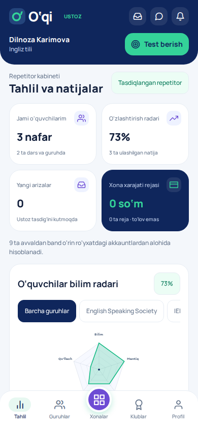 | 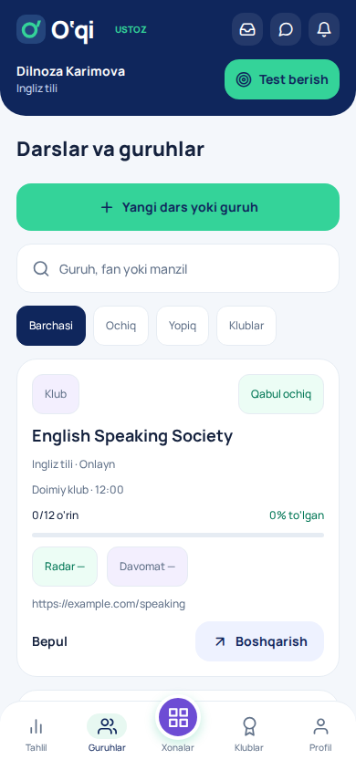 | 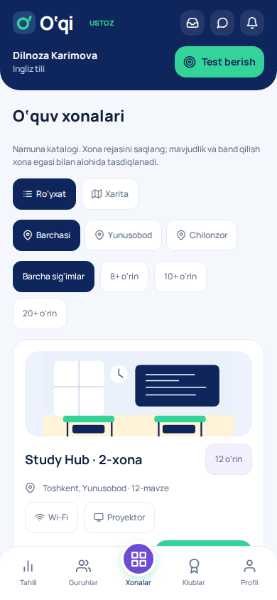 |

| Klublar                                   | Profil                                     | Xona sxemasi                           |
| ----------------------------------------- | ------------------------------------------ | -------------------------------------- |
| 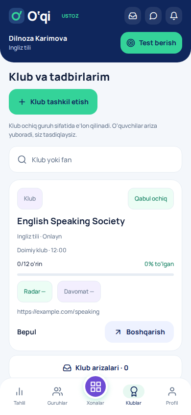 | 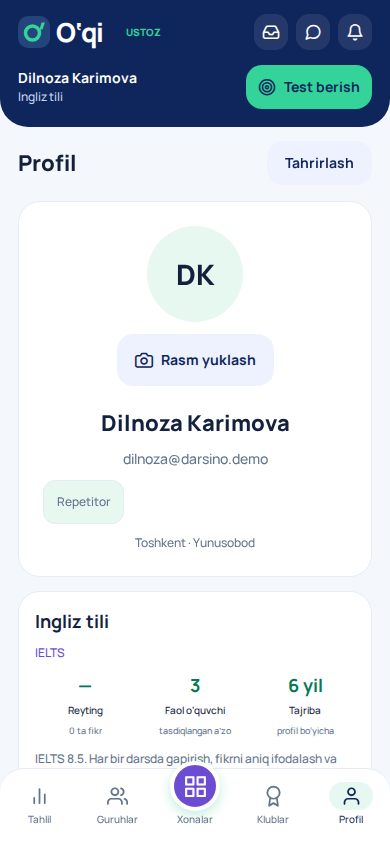 | 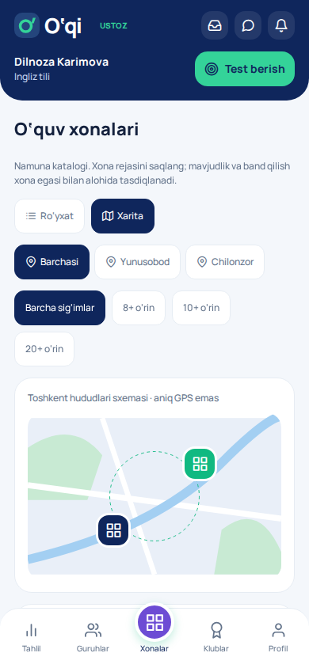 |

| Guruh radari                                   | 320 px tahlil                                  | 320 px xona rejasi                             |
| ---------------------------------------------- | ---------------------------------------------- | ---------------------------------------------- |
| 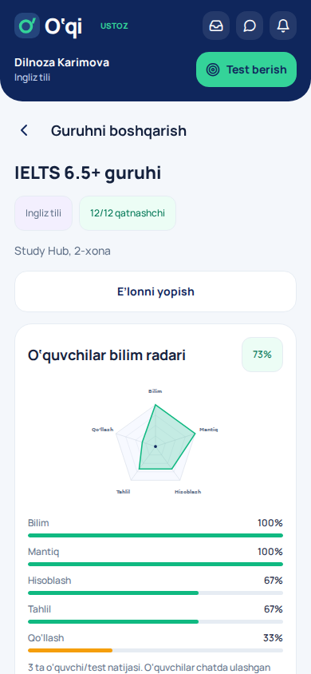 | 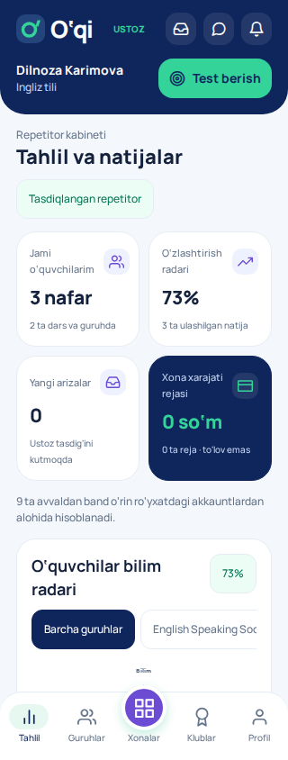 | 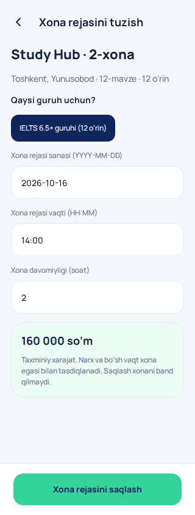 |

Ustoz rasmlarida namuna sifatida uch o‘quvchi va ular ulashgan javoblar ishlatilgan. Bu ma’lumotlar test fixture’iga tegishli, ilovaga yoki live bazaga qo‘shilmaydi. Oddiy demo akkauntda radar natija kelguncha bo‘sh turadi.

- **Tahlil va guruhlar:** o‘z guruhlarining faol a’zolari, haqiqiy arizalar, boshlangan darslarga belgilangan davomat, oldindan band o‘rinlar va yaqin dars. Radar ulashilgan test javoblaridan hisoblanadi; sun’iy o‘zlashtirish yoki davomat foizi yo‘q.
- **Diagnostika:** ustoz guruhning faol o‘quvchilariga mavjud shaxsiy chat orqali topshiriq yuboradi. O‘quvchi besh savolni tugatib, natijasini alohida tugma bilan ulashadi. Faqat haqiqiy ustoz topshirig‘i va taklif qilingan o‘quvchi javobi olinadi; ball qayta hisoblanadi. Boshqa shaxsiy progress uzatilmaydi.
- **Klublar:** tasdiqlangan ustoz bepul yoki pullik klub / tadbirni mavjud marketplace RPC orqali e’lon qiladi. Hech kim avtomatik a’zo qilinmaydi. O‘quvchi uni qidiruv va klublarda topadi, ariza yuboradi, ustoz tasdiqlaydi. Live bepul e’lon uchun [yangi SQL migratsiyasi](../supabase/migrations/202610150001_free_clubs.sql) zarur.
- **Xonalar:** namuna katalogi, hudud va sig‘im filtrlari, sxema, akkauntga alohida mahalliy reja, taxminiy xarajat va rejani olib tashlash. Guruh egasi, oflayn shakl, sig‘im, sana va reja vaqtlari to‘qnashuvi tekshiriladi. Bu haqiqiy bron yoki to‘lov emas; xona mavjudligi egasi bilan tasdiqlanadi. Xona rejasi Supabase’ga sinxronlanmaydi.
- **Profil:** haqiqiy fanlar, tajriba, sharhlardan hisoblangan reyting, faol a’zolar va xona xarajati rejasi. Pro obuna, tushum, balans yoki pul yechish xizmati ko‘rsatilmaydi.

## Tekshiruv

- TypeScript: `npm run typecheck`.
- 57 ta Auth / marketplace / PostgreSQL RLS / Storage / learning / teacher testi: `npm test`.
- Haqiqiy eksport qilingan Expo bundle bilan 4 ta JSDOM UI testi.
- Chromium: 7 ta E2E oqimi. O‘quvchi arizasi → ustoz tasdig‘i → jadval; email / bo‘sh qidiruv; test → radar → reload → boshqa akkaunt; 320 px qidiruv / xarita; ustoz testi → chat → o‘quvchi javobi → guruh radari / davomat; bepul klub → ariza → tasdiq → a’zolik; xona filtri / reja / reload / akkauntlar ajralishi.
- 390 va 320 px ekranlar ko‘zdan kechirildi; tor ekranda ustoz tasdiq belgisi alohida qatorga o‘tadi.
- Expo Web, iOS va Android bundle eksporti. Bu native qurilmada bajarilgan sinov yoki App Store / Play Store buildi emas.
- SQL bundle va migratsiyalar mosligi: `npm run supabase:check`; format: `npm run format:check`.

Live Supabase, email / OAuth, Realtime WebSocket, native picker va OS bildirishnomalari uchun loyiha / qurilma tekshiruvi hali kerak. SQL lokal PostgreSQL fixture’ida sinalgan, live loyihaga qo‘llanmagan.

Ochiq video manbalar: [Khan Academy — logarifmlar](https://www.khanacademy.org/math/algebra-home/alg-exp-and-log/v/logarithms), [Khan Academy — Nyutonning ikkinchi qonuni](https://www.khanacademy.org/v/newton-s-second-law-of-motion), [British Council — present continuous](https://learnenglishteens.britishcouncil.org/grammar/a1-a2-grammar/present-continuous).
